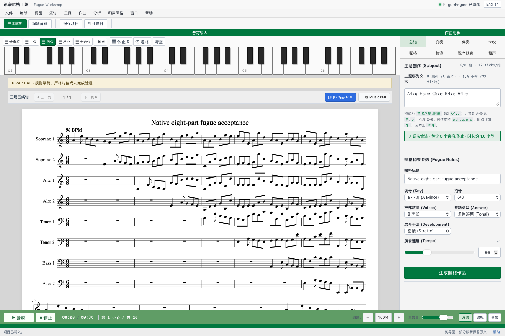
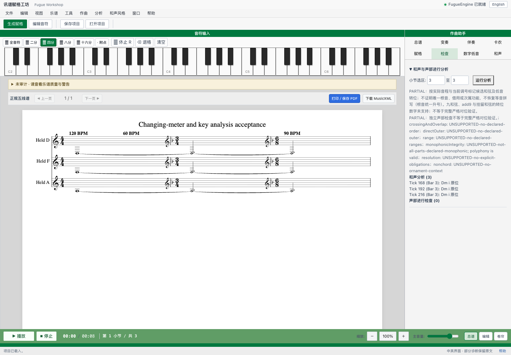
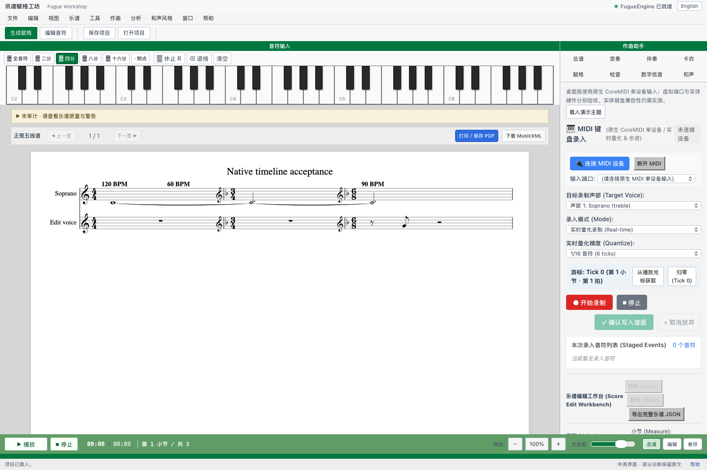

# Xunpu Fugue Workshop

A research and creative-workflow prototype for exploring fugue writing, score editing and musical analysis. This repository is a **public presentation** of the project, with a small static gallery and selected screenshots from actual development experiments.

> This is a work in progress. The images document particular test runs; they do not establish musical correctness, full feature coverage, or equivalence to any other product. The generation and analysis engines are not included in this repository.

## Experiment gallery

### Eight-part fugue draft

A native-workshop experiment showing an eight-part, 6/8 score and subject-entry controls. The original **PARTIAL** warning remains visible: this is a draft, and strict counterpoint was not fully validated in this run.

### Meter, key and analysis

An analysis view using a changing-meter and key test score. The panel reports partial coverage and unsupported checks; the screenshot should be read with those limitations.

### Timeline and MIDI input

A native interface experiment with tempo and meter changes, notation preview and a MIDI input panel. The screenshot shows no physical MIDI device connected and does not establish hardware compatibility.

## Explore the presentation

Open `index.html` in a browser to view the static gallery. No installation, server, account or network connection is required. This gallery is not the working composition application.

## Repository contents

- `index.html` and `style.css` — lightweight presentation code.
- `assets/` — selected, unaltered project screenshots.
- `src/meter.js` — the original standalone meter validation and tick conversion helper.
- `src/engraving.css` — the original score-preview styling from the workshop interface. These two files are selected non-core excerpts, not a runnable application.
- The original application, generation and analysis engines, private data, build artifacts and third-party software are intentionally not distributed here.

## Research status

The project explores subject input, multi-voice score workflows, notation, MIDI and analysis. Output can contain errors and requires independent musical review. Screenshots reflect individual development builds and should not be interpreted as a benchmark or as a promise of production functionality.

© Xunpu Fugue Workshop. All rights reserved. No license to reuse the source or images is granted by this repository.
